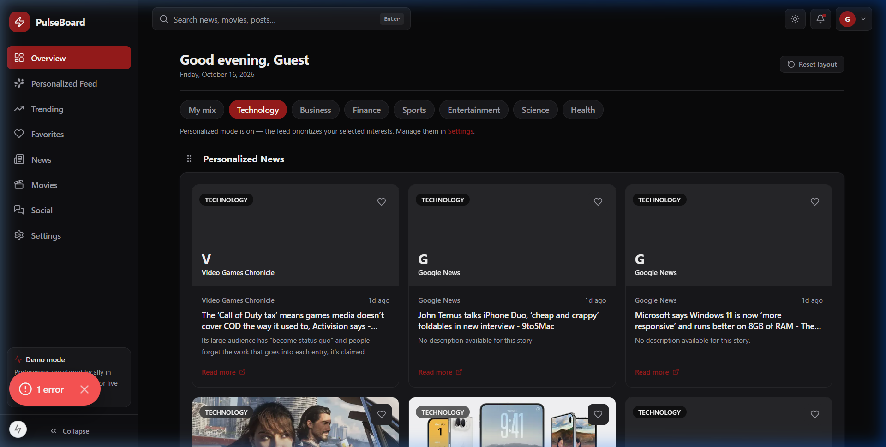
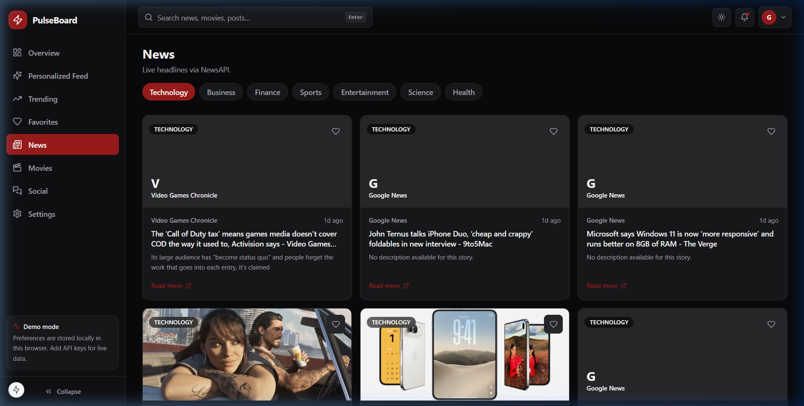
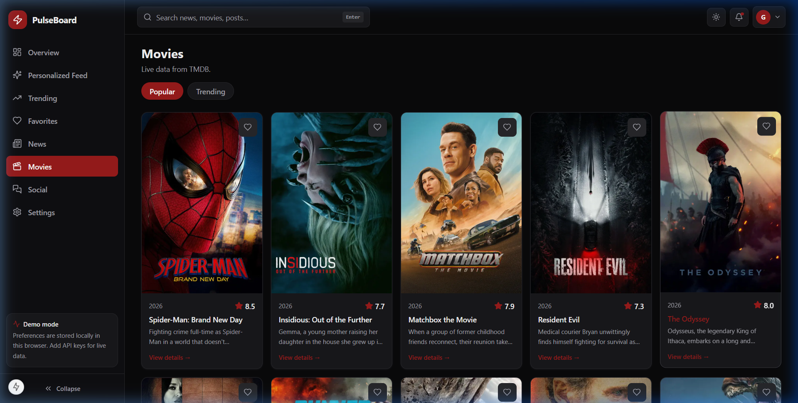
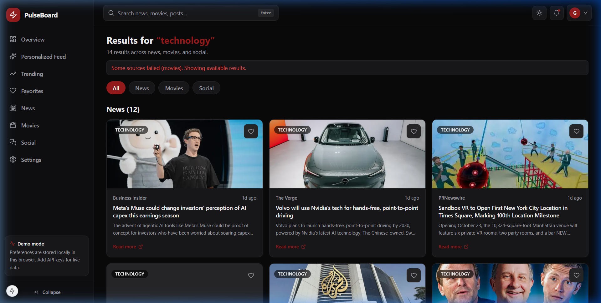
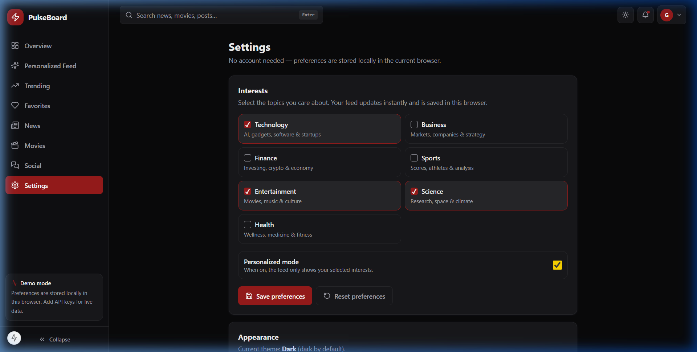

# PulseBoard — Personalized Content Dashboard

A polished, responsive dashboard for discovering **news**, **movies**, and **mock social posts** — personalized by interests, searchable, favoritable, themeable, and rearrangeable. Built with Next.js App Router, Redux Toolkit, Tailwind CSS, Framer Motion, and dnd-kit.

## Key features

- **Overview dashboard** with greeting, date, interest filters, draggable widgets, and a highlights rail.
- **Personalized feed** uniting news + movies + social, with All/News/Movies/Social tabs and category filters that actually filter.
- **News** via NewsAPI through secure server Route Handlers (`/api/news`, `/api/news/search`), with pagination, skeletons, retry, and labeled demo fallback.
- **Movies** via TMDB through server routes (`/api/movies/popular`, `/trending`, `/search`, `/[id]`), with posters, ratings, genres, details page, trailers, recommendations, and TMDB attribution.
- **Social** via deterministic mock API (`/api/social`) — every post labeled “Demo post”, interactive likes persisted locally.
- **Preferences** (multi-select interests + personalized mode) in Redux, persisted to LocalStorage, restored without hydration errors.
- **Favorites** for all three content types, persisted, deduplicated, filterable, with a functional Favorites page.
- **Global search** with ~300ms debounce, recent searches, suggestions, clear button, Enter-to-submit, URL query params (`/search?q=…`), category tabs, stale-response protection, and request cancellation.
- **Load-more pagination** via button + IntersectionObserver, with dedupe, end-of-results, and retry.
- **Drag-and-drop widgets** (dnd-kit) with handles, keyboard support, persisted order, and reset.
- **Dark/light themes** via CSS variables, persisted, no flash (inline init script), accessible contrast.
- **Animations** via Framer Motion (cards, drawer, drag), honoring `prefers-reduced-motion`.
- **Responsive** sidebar (collapsible desktop, drawer mobile), top bar, adaptive grids.
- **Tests**: Vitest unit + RTL integration + Playwright E2E, all runnable without API keys.

## Technology stack

| Area | Choice |
|---|---|
| Framework | Next.js 15.1.6 (App Router), React 19, TypeScript strict |
| Styling | Tailwind CSS 3.4, CSS custom properties |
| State | Redux Toolkit + react-redux (thunk-style async in hooks), typed hooks |
| DnD | @dnd-kit/core, @dnd-kit/sortable, @dnd-kit/utilities |
| Motion | Framer Motion 12 |
| Forms/validation | React Hook Form + Zod (+ @hookform/resolvers) |
| Icons | Lucide React |
| Tests | Vitest 3, Testing Library, Playwright 1.49 |
| Persistence | LocalStorage (preferences, favorites, theme, widget order, likes, recent searches) |

## Screenshots

### Dashboard — Dark Theme


### News


### Movies


### Search Results


### Settings


## Project structure

```text
src/
  app/
    page.tsx  layout.tsx  globals.css
    feed/ trending/ favorites/ news/ movies/ social/ settings/ search/
    movie/[id]/
    api/news{,/search}  api/movies/{popular,trending,search,[id]}  api/social/
  components/
    layout/ (Sidebar, Header, MobileNavigation, AppShell)
    dashboard/ (CategoryFilters, SortableWidget, RightRail)
    content/ (NewsCard, MovieCard, SocialPostCard)
    common/ (LoadingSkeleton, ErrorState, EmptyState, LoadMoreTrigger, FavoriteButton, CategoryBadge)
    settings/ (PreferencesForm, ThemeToggle)
  features/ (preferences, favorites, theme, dashboard slices)
  store/ (index, hooks, StoreProvider)
  lib/ (api/normalize, api/tmdb, api/client, constants, demo-data, utils, storage, validation)
  types/ (content)
  hooks/ (useDebounce, useLocalStorage)
tests/
  unit/  integration/  e2e/
```

## Prerequisites

- Node.js 20+ (tested on Node 22)
- npm 10+

## Installation

```bash
npm install
npm run dev
# open http://localhost:3000
```

## Environment variables

Create `.env.local` (never commit it; see `.env.example`):

```bash
NEWS_API_KEY=
TMDB_API_KEY=
```

| Variable | Where to get it | Notes |
|---|---|---|
| `NEWS_API_KEY` | https://newsapi.org → Get API Key (free dev key) | Used server-side only via `/api/news*`. Without it the app shows labeled demo articles + a notice. Dev keys support `top-headlines` and `everything`; plan limits are handled with clear errors. |
| `TMDB_API_KEY` | https://www.themoviedb.org → Settings → API (v3 key or v4 bearer token) | Both formats supported: a 32-char v3 key is sent as `api_key`, an `eyJ…` v4 token as `Bearer`. Without it the app shows demo titles + a notice. |

## Development commands

```bash
npm run dev        # start dev server
npm run build      # production build
npm run start      # serve production build
npm run lint       # Next.js ESLint
npm run typecheck  # tsc --noEmit
npm test           # vitest run (unit + integration)
npm run test:watch # vitest watch mode
npm run test:e2e   # playwright test (starts dev server automatically)
```

## Build commands

```bash
npm run build
npm run start
```

## Testing commands

```bash
npm test           # unit + integration (no keys, no network needed)
npm run test:e2e   # E2E against local dev server (auto-started by playwright config)
npx playwright install --with-deps chromium  # first-time browser install (or: npm run test:e2e:install)
```

## Deployment (Vercel)

1. Push to a public GitHub repo (no `.env.local`, `node_modules`, or `.next` committed).
2. Import the repo in Vercel → Framework preset **Next.js**.
3. Add Environment Variables: `NEWS_API_KEY`, `TMDB_API_KEY` (optional — app works in demo mode without them).
4. Deploy. No custom build command needed (`next build`). API Route Handlers run as serverless functions.

## API endpoints

All external keys stay server-side; the browser only calls these same-origin routes.

| Method | Route | Params | Description |
|---|---|---|---|
| GET | `/api/news` | `category`, `page` | Top headlines for an interest. `source: live\|demo`. |
| GET | `/api/news/search` | `q`, `page` | News search (NewsAPI `everything`). |
| GET | `/api/movies/popular` | `page` | TMDB popular movies, normalized. |
| GET | `/api/movies/trending` | `page` | TMDB weekly trending movies. |
| GET | `/api/movies/search` | `q`, `page` | TMDB title search. |
| GET | `/api/movies/[id]` | — | Details + trailer key + recommendations. Accepts TMDB numeric id or `movie-<id>`. Demo fallback included. |
| GET | `/api/social` | `category?`, `q?`, `page` | Deterministic mock posts, `source: demo`. |

Error shape: `{ results: [], error: string, source }` with appropriate HTTP status (400 bad input, 429 rate limit, 502 provider failure). Secrets are never logged.

## Demonstration mode

- When `NEWS_API_KEY` / `TMDB_API_KEY` are absent, routes return deterministic sample data with `source: "demo"` and a UI notice (“Demonstration data — configure API keys…”).
- Social posts are **always** simulated and every card/dialog says “Demo post”.
- Demo and live data are never mixed without labeling.

## Architectural decisions

- **Server routes as API gateway**: keys never reach the browser; normalization (`normalizeNewsArticle`, `normalizeTmdbMovie`) keeps client types stable despite provider quirks.
- **Redux for UI state, LocalStorage for persistence**: slices own preferences/favorites/theme/layout; storage helpers validate on read (corrupt data → safe defaults) and hydration happens client-side to avoid SSR mismatch.
- **Stale-response guards**: search and paginated hooks use incrementing request ids + `AbortController` so slow responses can’t overwrite newer ones; in-flight dedupe prevents double fetches.
- **Semantic theme tokens** (`--bg`, `--card`, `--accent`, …) consumed via Tailwind extension, so dark/light stay consistent without duplicated hex values.
- **Deterministic demos** keep UI and tests predictable offline.

## Known limitations

- NewsAPI dev plans restrict some endpoints/countries; the UI surfaces provider errors instead of hiding them.
- Demo movie posters hotlink TMDB image CDN (real artwork for well-known titles) even in demo mode; ratings shown are the titles’ actual TMDB values, labeled demo only because the list wasn’t fetched live in that session.
- No real auth — by design, preferences live in the browser (stated in Settings and footer).
- E2E tests assume a local dev server (Playwright starts it automatically).

## Accessibility & performance

- Skip link, landmarks, heading hierarchy, labeled inputs, `aria-pressed`/`aria-selected`, focus-visible rings, alt text, keyboard-operable drawer + drag handles, `prefers-reduced-motion` support.
- `next/image` with sizes, client components only at leaves, debounced search, paginated lists, `revalidate` caching on server fetches (5–10 min), lazy-friendly grids, no Redux duplication of server data.
